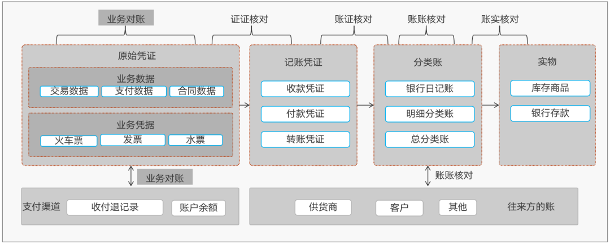

# 对账系统（财务对账 · 一期）

一套自研财务对账系统：自有支付流水 vs 渠道清算账单的 **交易对账**，覆盖「解析 → 上传入库 → 定时/手工对账 → 结果 → 差异处理 SOP」全生命周期。



## 快速开始

```bash
make up          # 起 postgres/redis/web/worker/beat/frontend 全栈（:80）
docker compose exec web python manage.py migrate
docker compose exec web python manage.py seed_demo    # 演示数据 + admin 账号
make smoke       # 全链路 Playwright 冒烟（上传→对账→结果→差错→工作台）
```

打开 http://localhost/ ，账号 `admin / Admin@123`（seed_demo 后）。

## 能力（一期）

- **认证**：本地账号密码 + OIDC SSO（自动建号/角色映射），admin/operator 双角色
- **配置域**：渠道/资金账户/业务类型/差错处理类型/解析规则（列映射+值映射+编码回退）/获取任务/对账项目（A/B 源+筛选+状态集+b_sum）
- **数据接入**：xlsx/csv/txt 解析（Decimal quantize 转分、整批校验回滚）、上传防重/覆盖重传（PROTECT 保护已对账数据）
- **对账引擎**：连续性控制、行锁并发抢占、beat 定时扫描（T+1）、匹配算法（对平/单边/错账/1vN 汇总，确定性 group_no 幂等重对）
- **差错处理**：按组物化、SOP 类型处理、全量留痕时间线、重对安全
- **工作台**：总览三卡片、站内+邮件告警、失败重跑
- **可观测**：OpenAPI 全端点类型化（/api/docs/ Swagger、/api/redoc/）

## 文档索引

- 规格：`docs/superpowers/specs/2026-10-31-对账系统-design.md`
- 一期计划：`docs/superpowers/plans/2026-10-31-对账系统一期.md`
- 计划评审：`docs/superpowers/reviews/2026-11-03-一期plan评审报告.md`
- 部署：`DEPLOY.md`
- 领域参考：`docs/reference/一文搞懂对账系统-正文.md`

## 路线图

- **一期（本仓库 v1.0.0-phase1）**：交易对账全链路（上文能力）
- **二期**：资金对账（清算 vs 结算）、余额调节、差错统计报表
- **三期**：获取方式扩展（API/SFTP）、自动重对、差错处理工作流审批

## 开发

```bash
make test        # 本地 venv pytest（需 postgres/redis up）
make test-docker # web 容器内 pytest（验收口径）
```

技术栈：Django 5 + DRF + Celery + PostgreSQL + Redis + Vue3 + Element Plus + Playwright。
